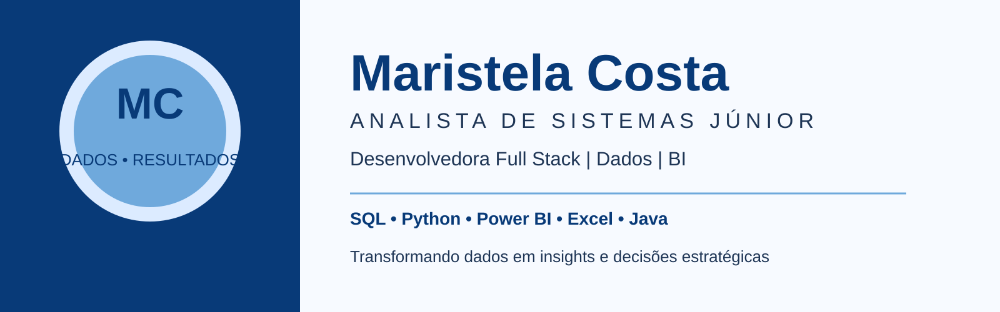

  

<h1 align="center">Olá, eu sou Maristela Costa 👋</h1>

<h3 align="center">
📊 Analista de Dados Jr. | Business Intelligence | SQL | Power BI
</h3>

🎓 Graduada em Sistemas de Informação 
🎓 MBA em Business Intelligence, Big Data & Analytics (em andamento) 
🎓 MBA em Cibersegurança e Proteção de Dados (em andamento)

  
  
  
  
  

---

## 👩‍💻 Sobre Mim

Sou graduada em **Sistemas de Informação** e apaixonada por tecnologia, análise de dados e melhoria de processos. Possuo conhecimentos em **SQL, Power BI, Excel, Python, Java e Banco de Dados**, aplicando essas ferramentas para transformar dados em informações estratégicas que apoiam a tomada de decisões.

Atualmente, estou aprofundando meus conhecimentos por meio de MBAs em **Business Intelligence, Big Data & Analytics** e **Cibersegurança e Proteção de Dados**, buscando unir visão analítica, tecnologia e resultados de negócio.

---

## 📈 Destaque Profissional

Participei de um projeto de otimização da produção de semicases, realizando o acompanhamento de custos, produtividade e indicadores operacionais.

✅ Redução do prazo de produção de **10 para 5 dias**

✅ Aumento da produtividade operacional

✅ Maior capacidade de atendimento de pedidos

✅ Melhoria do controle de custos e processos

✅ Apoio à tomada de decisão baseada em indicadores

---

## 🚀 Projetos em Destaque

### 📊 Painel BI Analytics

Projeto voltado ao acompanhamento de indicadores estratégicos, métricas operacionais e apoio à tomada de decisão.

**Tecnologias:** Power BI • SQL • Excel • Analytics

---

### 🤖 Plataforma de Inteligência de Negócios e IA

Projeto voltado para Business Intelligence, análise de dados e geração de insights estratégicos.

**Tecnologias:** Python • SQL • Analytics • IA

---

### 📈 Análise de Vendas com R

Projeto de análise exploratória de dados para acompanhamento de vendas, faturamento e desempenho comercial.

**Tecnologias:** R • Estatística • Data Analytics

---

### 📦 Projeto de Inventário TI

Sistema para controle e gerenciamento de ativos de tecnologia.

**Tecnologias:** Java • SQL • Banco de Dados

---

### 💻 TI Helpdesk System

Sistema para abertura, acompanhamento e gestão de chamados técnicos.

**Tecnologias:** Java • MySQL • Sistemas Web

---

### 🔐 Scanner de IP

Ferramenta para análise e monitoramento de redes.

**Tecnologias:** Python • Redes • Segurança da Informação

---

## 🛠️ Competências Técnicas

- SQL
- Power BI
- Excel Avançado
- Python
- Java
- Banco de Dados
- Business Intelligence
- Data Analytics
- Git e GitHub
- Governança de TI
- LGPD
- Segurança da Informação

---

## 🎓 Formação Acadêmica

🎓 Bacharelado em Sistemas de Informação

🎓 MBA em Business Intelligence, Big Data & Analytics (em andamento)

🎓 MBA em Cibersegurança e Proteção de Dados (em andamento)

---

## 📚 Certificações

- Gerência de Projetos de TI
- Implantação de Governança de TI
- Programação para Internet
- Programação Mobile Android e iOS
- Programação de Algoritmos Escaláveis

---

## 📊 Estatísticas GitHub

  
  

---

## 📫 Conecte-se Comigo

📧 **maristelagatinhapreta@gmail.com**

📍 **Curitiba - PR**

---

### 💡 Frase Profissional

> **"Transformando dados em insights para impulsionar resultados e apoiar decisões estratégicas."**

⭐ Obrigada pela visita ao meu perfil!
